# Calendar Alerts for Stream Deck

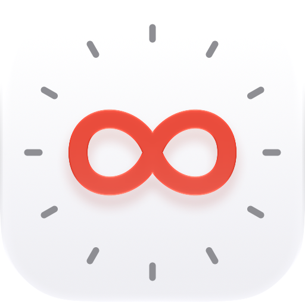

A Stream Deck plugin for macOS that puts your next calendar event, or reminder, on a key. It counts down to it with color-coded urgency, plays an alert sound as it gets close, and flashes **NOW** in the final minute. Press the key to open it; hold the key to join the meeting, or to mark the reminder done.

<p>
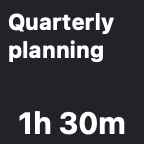
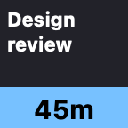
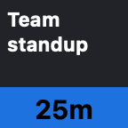
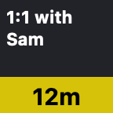
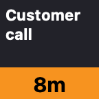
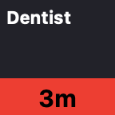

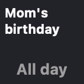
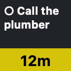
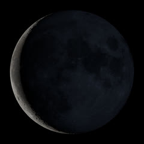
</p>

**[Download the installer](https://github.com/jangellx/StreamDeck-Calendar-Alerts/releases/latest/download/com.joeangell.calendar-alerts.streamDeckPlugin)**. Requires macOS 14 or later and Stream Deck 6.4 or later.

The plugin's website is **[sdcalendaralerts.tmproductions.com](https://sdcalendaralerts.tmproductions.com/)**.

## What it shows

The key shows the title of your next event or reminder today and how long until it's due:

| Time until it starts | Key |
|---|---|
| 60 minutes or more | Hours and minutes, no color (`1h 30m`) |
| 31–59 minutes | Light blue |
| 16–30 minutes | Blue |
| 11–15 minutes | Yellow |
| 6–10 minutes | Orange |
| 1–5 minutes | Red |
| Final minute | Flashing red **NOW** |

- Your Mac's alert sound plays at 60, 30, 15 and 5 minutes before each event. You can choose other times, or turn it off (see below).
- Only events still to come today are shown. Cancelled events and events you've declined are skipped.
- When there are no timed events left today, the key shows today's all-day event instead, such as a birthday or a holiday, marked **All day**. If there's more than one, it shows the first and how many others there are (**All day +2**).
- A leading room number is trimmed from titles, so "101 Team Standup" shows as "Team Standup".
- When there's nothing left today, the key shows tonight's moon phase, or whichever image you've picked (see below).

### Reminders

 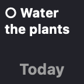 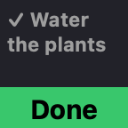

Turn on **Reminders due today** in a key's settings to show reminders from the Reminders app too, marked with an open circle like the one in Reminders. The first time you do, macOS asks whether "StreamDeck Calendar Alerts" can access your reminders.

- A reminder due at a time counts down like an event, with the same colors and alerts.
- A reminder due today with no time shows like an all-day event, marked **Today**. One whose time has passed but isn't done stays on the key, marked **Overdue**. These show before all-day events, so marking one done moves the key on.
- Only reminders due today are shown, not ones left over from earlier days.
- Hold the key, or double-press it, to mark the reminder done. The key shows **Done** for 5 seconds; hold or double-press again while it does to mark the reminder not done.

### Joining meetings

When an event has a video meeting link in its URL, location or notes, holding the key or double-pressing it joins the meeting. Links from Zoom, Google Meet, Microsoft Teams, Webex, GoTo Meeting, Whereby, Jitsi Meet, Amazon Chime, FaceTime and Slack huddles are recognized. Zoom and Teams links open straight in their apps when they're installed.

A single press acts at once unless the key has something else to do on a hold or double press (a reminder, or an event with a meeting link). Then it waits a moment to see whether a second press follows.

## Settings

Select the key in the Stream Deck app to see its settings. Each key has its own, so you can have one key for work calendars and another for family, or one just for reminders.

- **Show**: check **Calendar events** and choose the calendars to include, and check **Reminders due today** and choose the lists to include. All calendars and lists are included until you uncheck one.
- **Scheduled and all-day**: **Scheduled** counts down to events and reminders with a start time. **All-day** shows all-day events, and reminders with no time or past their time, once nothing scheduled is left today. Uncheck **Scheduled** for a key that only shows all-day items, or **All-day** to skip them. Check **Stop showing them at** and pick a time to stop showing all-day items then each day; after it, the key shows your "no more events" image instead. A summary under these options says what the key will show through the day.
- **Alert sound**: uncheck **Play an alert before each event** for a silent key, or check the times you want: 1 hour, 30, 15 or 5 minutes before. **Every minute for the last 5 minutes** plays it at 5, 4, 3, 2 and 1 minutes before.
- **When pressed, open**: the app or web calendar to open. Events and reminders each have their own menu (the reminders menu appears when the key shows reminders, and opens Reminders unless you choose otherwise). The menu lists the calendar, meeting and task apps you have installed (such as Fantastical, BusyCal, Outlook, Zoom or Things), web calendars (Google Calendar, Outlook on the web, Outlook.com, iCloud and Proton Calendar), **Another app…** for any other app on your Mac, and **Web page or URL…**.

  Where an app supports it, pressing the key shows the event the key is counting down to:

  | Open in | Pressing the key shows |
  |---|---|
  | Calendar | The event |
  | BusyCal | The event |
  | Notion Calendar | The event (for Google and other accounts where macOS knows the account's email address) |
  | Fantastical | The event's day (Fantastical can't be linked to a single event) |
  | Google Calendar | The event's day, in the Google account the event belongs to |
  | Anything else | The app or page, as it last was |

  An all-day event on the key opens the same way. A reminder opens at the reminder in Reminders, or on its day in Fantastical or Google Calendar. When there's nothing left today, the key just opens the app.

  **Pressing the key** chooses what a single press does, separately for events and reminders. For events: **Opens the event** (the default; holding or double-pressing joins the meeting) or **Joins the meeting** (holding or double-pressing opens the event; an event with no meeting link opens with a single press). For reminders: **Opens the reminder** (holding or double-pressing marks it done) or **Marks it done** (holding or double-pressing opens it).
- **When there are no more events**: choose what the key shows.

   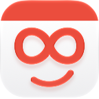 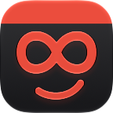 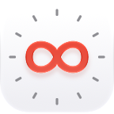 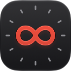 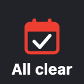 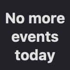

  - **Moon phase** (the default) shows tonight's actual moon.
  - **Pictures:** a smiling calendar or an infinity clock (each in light or dark), or a checkmark calendar.
  - **Emoji:** a checkmark ✅, a thumbs-up 👍 or a crescent moon 🌙.
  - **Text only** shows the words "No more events today".
  - **Your own message…** shows whatever you type. It's sized to fit the key, and line breaks you type are kept.
  - **Your own image…** shows a picture of your choice. Drag an image file onto the settings panel, or click **choose a file**. It's scaled to fit the key.

## Install

### With the installer

1. Download **[com.joeangell.calendar-alerts.streamDeckPlugin](https://github.com/jangellx/StreamDeck-Calendar-Alerts/releases/latest/download/com.joeangell.calendar-alerts.streamDeckPlugin)** from the [latest release](https://github.com/jangellx/StreamDeck-Calendar-Alerts/releases/latest).
2. Double-click it. The Stream Deck app opens and asks to install the plugin.
3. In the Stream Deck app's action list, find the **Calendar Alerts** group and drag **Next Appointment** onto a key.
4. When macOS asks whether "StreamDeck Calendar Alerts" can access your calendars, click **Allow**. If you turn on reminders, it asks about those too.

To update, download and double-click the newer installer the same way.

### Without the installer

**Copy it in by hand.** The `.streamDeckPlugin` file is a zip archive.

1. Download it, change its extension to `.zip`, and double-click it to unzip.
2. Quit the Stream Deck app.
3. Move the `com.joeangell.calendar-alerts.sdPlugin` folder into `~/Library/Application Support/com.elgato.StreamDeck/Plugins/`, replacing any older copy.
4. Open the Stream Deck app again, then carry on from step 3 above.

**Build it from source.** You need macOS 14 or later, Xcode 16 or later, and a code-signing identity. Signing into Xcode with any Apple ID (Xcode → Settings → Accounts) gives you a free "Apple Development" identity.

```bash
git clone https://github.com/jangellx/StreamDeck-Calendar-Alerts.git
cd StreamDeck-Calendar-Alerts
./deploy.sh
```

`deploy.sh` builds the plugin, signs it with your first Apple Development identity (set `SIGN_ID` to use another), quits Stream Deck, installs the plugin into Stream Deck's Plugins folder, and starts Stream Deck again. Run it again after each change.

### Making the installer

`./package.sh` builds `dist/com.joeangell.calendar-alerts.streamDeckPlugin`, signed with a Developer ID certificate and notarized by Apple so it opens on any Mac. It needs a paid Apple Developer Program membership and this one-time setup:

1. In Xcode → Settings → Accounts → Manage Certificates, click **+** and add a **Developer ID Application** certificate.
2. Save notarization credentials (this prompts for an [app-specific password](https://support.apple.com/102654)):
   ```bash
   xcrun notarytool store-credentials CalendarAlerts --apple-id <your Apple ID> --team-id <your team ID>
   ```

Then attach the file to a GitHub release. The download links above always point at the newest release, as long as the file keeps that name. `./package.sh --skip-notarize` builds an un-notarized copy for testing on your own Mac.

## How it works

The plugin has three parts:

- **The plugin program** (`StreamDeck Calendar Alerts`): a Swift command-line program that Stream Deck starts. It talks to the Stream Deck app over its local WebSocket. Once a minute it draws each key's image, plays alert sounds, and opens your chosen app when a key is pressed.
- **CalendarHelper.app**: the same program, run as a small background app. macOS ties calendar permission to the app that asks for it, and a plugin started by Stream Deck would be asking on Stream Deck's behalf. So the plugin starts this helper, which asks for calendar access under its own name ("StreamDeck Calendar Alerts") and reads today's events with EventKit. Once a key shows reminders it asks for reminders access too, reads today's reminders, and marks one done when the plugin asks it to. It saves the events, reminders, and the calendar and reminder lists to `~/Library/Caches/com.joeangell.calendar-alerts/`, both when a calendar changes and every 30 seconds, and the plugin reads them from there. The helper quits when the plugin does.
- **The settings panel** (`propertyinspector/index.html`): the web page Stream Deck shows when you select the key. It saves each key's settings in Stream Deck.

```
Stream Deck app ⇄ WebSocket ⇄ plugin program ──starts──▶ CalendarHelper.app ⇄ EventKit
                                     ▲                           │
                                     └── reads ── ~/Library/Caches/com.joeangell.calendar-alerts/ ◀── writes
```

### Project layout

| Path | What it is |
|---|---|
| `StreamDeck Calendar Alerts/` | Swift sources for the plugin program and helper |
| `propertyinspector/` | The settings panel |
| `Images/` | Icons and key images (made by `Tools/make-images.sh`) |
| `manifest.json` | Stream Deck's description of the plugin |
| `deploy.sh` | Build and install on this Mac |
| `package.sh` | Build the signed, notarized installer |
| `Tools/` | Shared build steps and the image generator |

## Troubleshooting

- **The key says "No calendar access".** Open System Settings → Privacy & Security → Calendars and turn on **StreamDeck Calendar Alerts**. The key updates within a minute.
- **Reminders don't show, and the settings say "Reminders access not granted".** Open System Settings → Privacy & Security → Reminders and turn on **StreamDeck Calendar Alerts**.
- **To be asked for calendar or reminders access again**, reset the permission and restart Stream Deck:
  ```bash
  tccutil reset Calendar com.joeangell.calendar-alerts
  tccutil reset Reminders com.joeangell.calendar-alerts
  ```
- **Stream Deck's own log** is at `~/Library/Logs/ElgatoStreamDeck/StreamDeck.log`. Search it for `calendar-alerts`.

To uninstall, quit Stream Deck and delete `~/Library/Application Support/com.elgato.StreamDeck/Plugins/com.joeangell.calendar-alerts.sdPlugin` and `~/Library/Caches/com.joeangell.calendar-alerts`.

## Credits

- The idea, and the colors for each stage of the countdown, come from TJ Luoma's [icalbuddy-km-and-stream-deck](https://github.com/tjluoma/icalbuddy-km-and-stream-deck). It uses icalBuddy and Keyboard Maestro to show the time until your next meeting on a Stream Deck key.
- I had trouble with the shell scripts, so I switched to Shortcuts before writing this plugin. That idea came from ringmaster's [iCal Daily Schedule via iOS/OSX Shortcut](https://forum.obsidian.md/t/ical-daily-schedule-via-ios-osx-shortcut/30686) on the Obsidian forum.
- The moon-phase images are courtesy of **NASA's Scientific Visualization Studio**, from its [Dial-A-Moon](https://svs.gsfc.nasa.gov/gallery/moonphase/) gallery, made with data from NASA's Lunar Reconnaissance Orbiter.
- The plugin icon, the smiling calendar and the infinity clock are from my app Perpetual, and the moon phase is worked out the way Perpetual does it. The other images are drawn in code.
- Opening an event in Apple Calendar uses the `ical://ekevent/` link that [MeetingBar](https://github.com/leits/MeetingBar) uses; Apple doesn't document it. The other apps' links come from their own documentation: [Fantastical](https://flexibits.com/fantastical/help/integration), [BusyCal](https://www.busymac.com/docs/busycal/70621-url-handler) and [Notion Calendar](https://cronhq.notion.site/Cron-API-c0ad725e3b654c64a6d3fa7ae71fa8b3).
